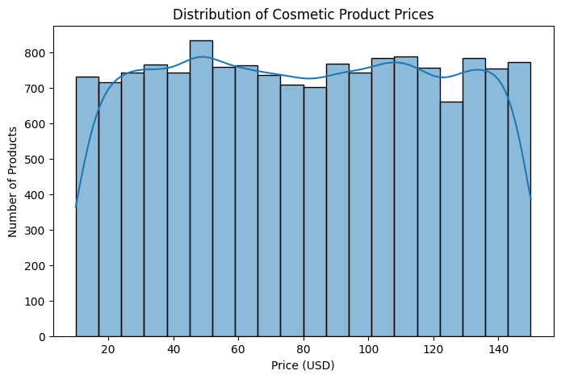
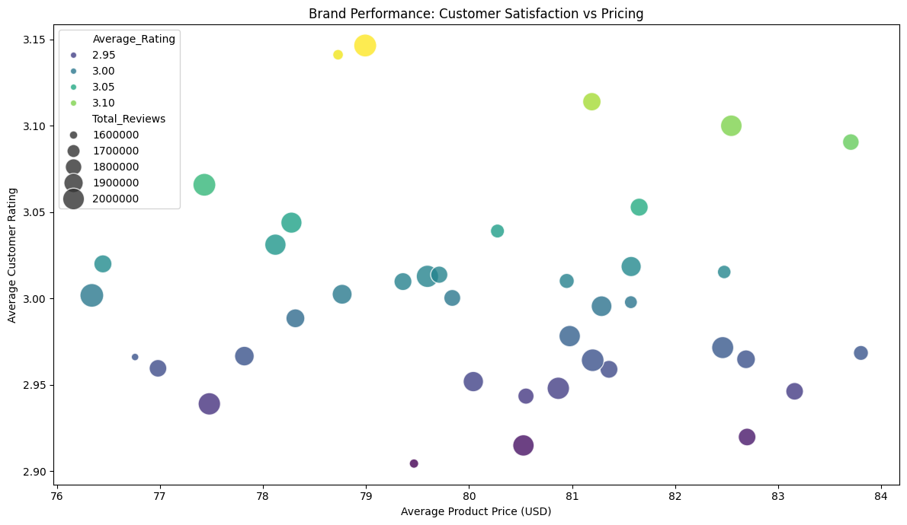

# Skin-Care 

 ! [Photo of beauty](https://github.com/Queenmunyere/Skin-Care-App/blob/main/Pink%20Sakura%20Skincare%20Set%20for%20Teens%20%F0%9F%8E%80%20Cute%20Self-Care%20Gift%20Idea%20%26%20Kawaii%20Beauty%20Essentials%20(1).jpg)
 
 

This project aims at build a model that will ask people from all over to self analysis there skin and know the needs of their own skin without visiting the dermatologists.
## 2. Business Understanding

### 2.1 Business Problem
* Consumers have many beauty and cosmetic products to choose from, but selecting an 
appropriate product can be difficult because products differ in price, ratings, ingredients, skin-type suitability, usage frequency, and other characteristics.
* At the same time, beauty businesses need to understand which types of products are popular, 
highly rated, and likely to attract customers.
* Therefore, there is a need for a data-driven system that can analyze product information and 
identify important patterns that can support better product selection and business decisio-making

### 2.2 Project Aim
* The main aim of this project is to analyze beauty and cosmetics product data and develop a data-driven product recommendation or prediction system that can help consumers identify suitable products while providing useful business insights.

### 2.3 Specific Objectives

The project will:
1.  Identify the most popular product categories and brands.
2.  Analyze the relationship between product prices, ratings, and number of reviews.
3.  Determine which products are associated with different skin types.
4. Investigate the relationship between usage frequency and product characteristics.
5.  Analyze consumer preferences across different product categories.
6.  Develop a machine learning model for product recommendation or prediction.
7.  Evaluate the performance of the developed model.
8.  Provide recommendations that can support consumers and beauty businesses.

### 2.4 Key Business Questions

The project will attempt to answer questions such as:
1.  Which beauty product categories are most common?
2.  Which brands have the highest-rated products?
3. Does price influence product ratings?
4.  Which products receive the largest number of reviews?
5. Which products are suitable for different skin types?
6. What usage frequencies are most common?
7.  Are cruelty-free products associated with different ratings or prices?
8. Which product characteristics can be used to recommend suitable products

### 3.1 Dataset Description
- The dataset contains 15,000 beauty and cosmetics product records with 14 variables.
- Data source is from [Hugging face](https://huggingface.co/join?next=https%3A%2F%2Fhuggingface.co%2Fdatasets%2Fk-master%2Fk-beauty-ai-citation-dataset)

Variable                         What it represents
Product_name                     Name of the beauty product
Brand                            Manufacturere or brand
Category                         Product classification
Skin_Type                        Intended skin type
Gender_Target                    Intended skin type
Price_USD                        Product price in USD
Rating                           Customer product rating
Number_of_Reviews                Number of customer reviews
Main_Ingredient                  Main product ingredient

## DATA VISUALIZATION

### Findings 
- Dataset contains cosmetic products across a broad range of prices,with a relatively even distribution across price intervals.
- Highly suggesting that the dataset represents different price segments rather than concentrating mainly on low-priced or high-priced products.

### How to interpret the graph:
- High rating, low price: Brands offering relatively affordable products with high average ratings.
- High rating, high price: Brands with higher-priced products and high average ratings.
- Low rating, high price: Brands that may need to review product quality, value, or customer expectations.
- Low rating, low price: Affordable brands whose products may have opportunities for improvement.
- Larger circles: Brands with more reviews across their products, based on their total review count.

## Model and Evaluation.
- Select input features
- Preprocess the features
    - Numeric-transformer
    - Categorical-transformer
    - Column-transformer
- Transform product features
    - Product_matrix
- Calculate cosine similarity
    - Similarity_matrix

### MODELS
- Decision Tree
- Random Forest
- Linear regression - being the best model
- Content based recommendation

## Live Application - Streamlit
https://skin-care-app-nqpcqo83qr6rttjctkjune.streamlit.app/

## Overall Conclusion
- The project evaluated three machine learning models to determine their ability to predict the target variable in the Beauty and Cosmetics dataset. Linear Regression achieved the best relative performance.

## Recommendations

1. Personalised product recommendations: Beauty companies should consider customers' skin types, gender preferences and skincare needs when recommending products to improve product suitability.

2. Improve product selection: Consumers should consider product categories and main ingredients when selecting skincare products to ensure that their choices align with their skincare requirements.

3. Monitor customer satisfaction: Brands should regularly analyse customer ratings and reviews to understand consumer experiences, identify areas for improvement and maintain product quality.

4. Competitive pricing strategies: Beauty companies should evaluate product prices across different categories and brands to establish competitive and affordable pricing strategies.

5. Brand performance improvement: Businesses should use customer feedback, product ratings and pricing information to identify strengths and weaknesses in their product offerings.

6. Ingredient transparency: Manufacturers should provide clear information about product ingredients to help consumers make more informed purchasing decisions.

7. Adopt data-driven recommendation systems: Beauty businesses should embrace data analytics and recommendation technologies to improve product discovery, personalise customer experiences and support better purchasing decisions.

8. Continuous dataset improvement: Additional information about customer preferences, product effectiveness and purchasing behaviour should be collected to improve the accuracy and usefulness of future analyses.

